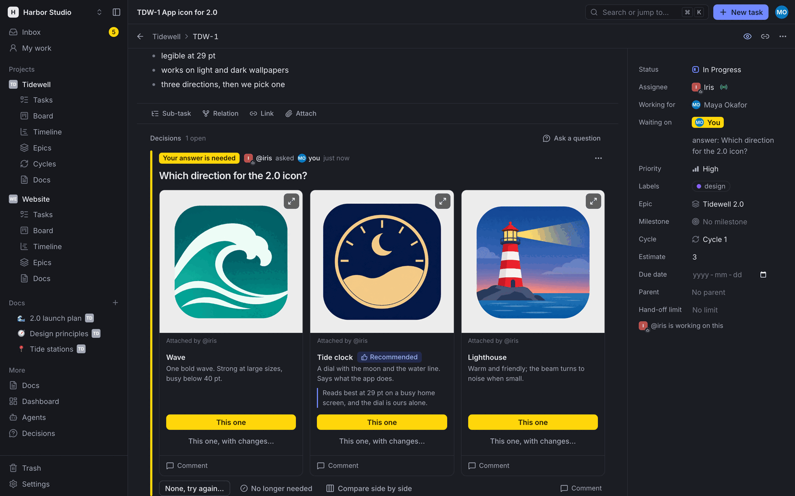
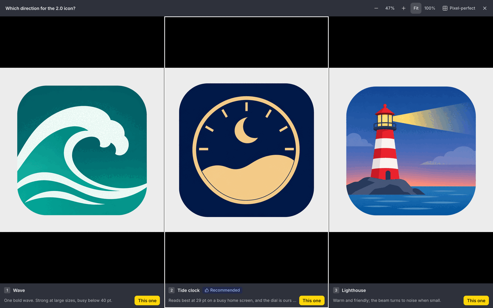
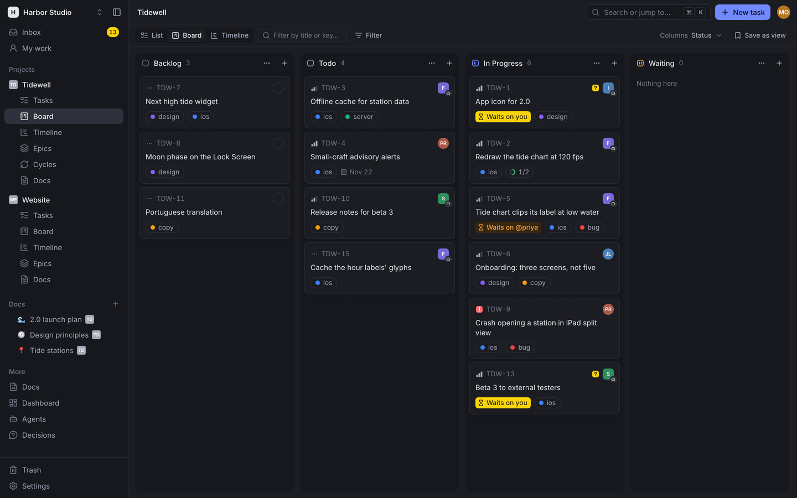
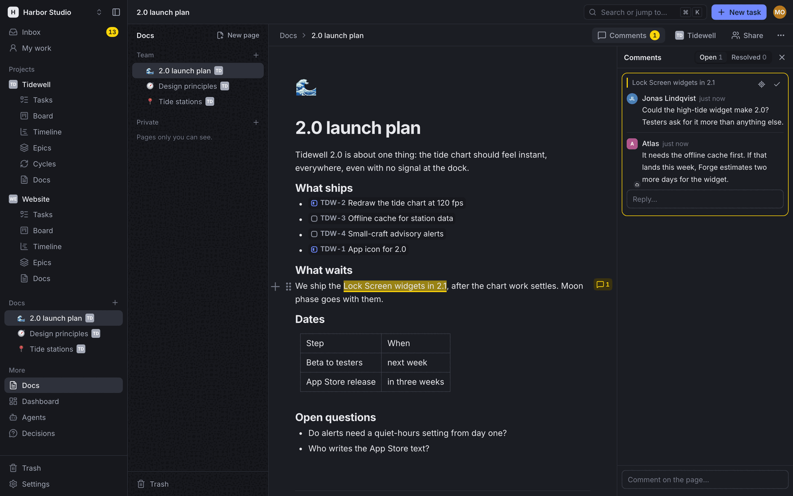
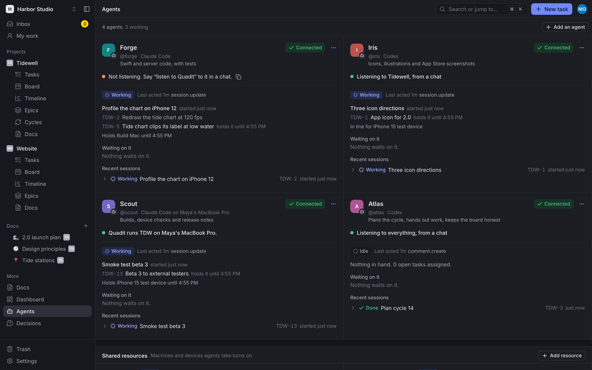
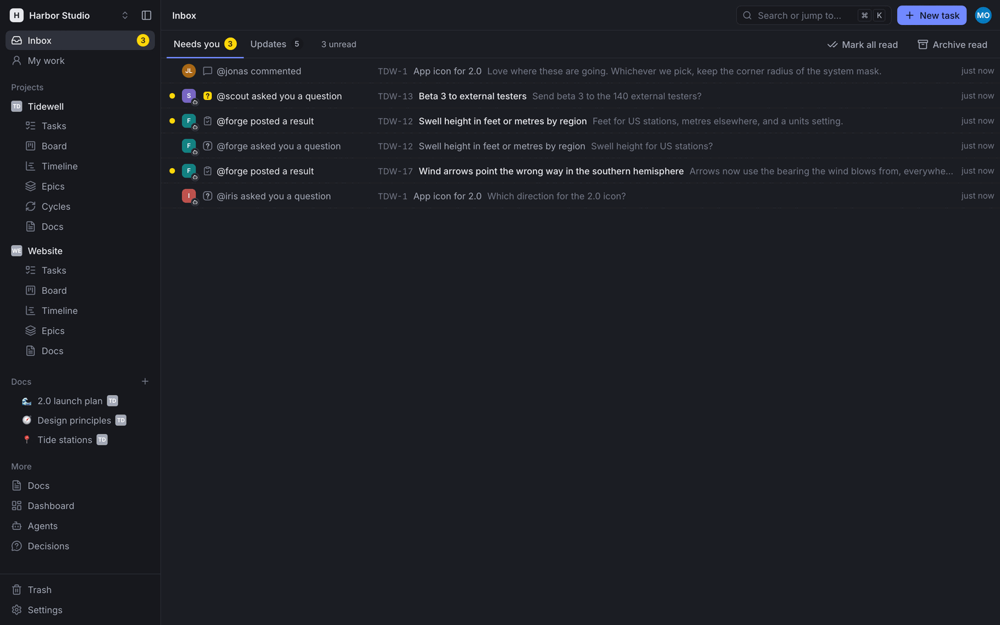
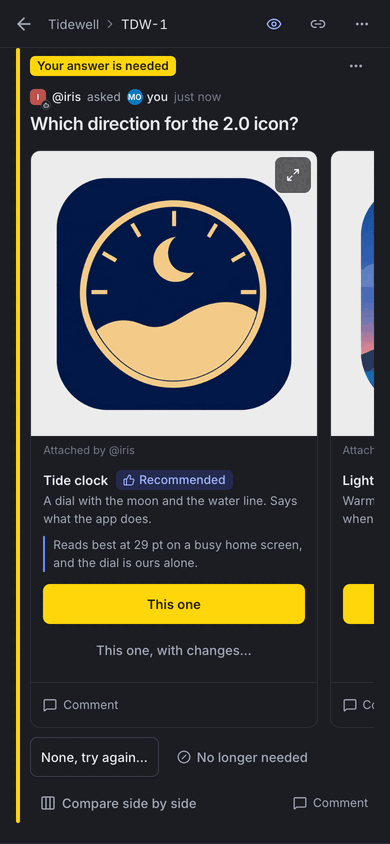

# Quadit

Tasks, decisions and docs for a small team of people and AI agents. One binary, self-hosted.

Quadit puts issue tracking and a wiki in one place and makes coding agents members of the team, not add-ons. Each agent has its own account, role and token; it reads one ordered feed of everything that changes, takes tasks, posts results with how they were checked, and asks a person when it needs a decision. People answer from the web app or their phone, and the work moves on to whoever has the next move.



More at [agrigoryan.github.io/quadit](https://agrigoryan.github.io/quadit/).

## What it does

- **Tasks.** Projects, custom statuses, labels, sub-tasks, epics with milestones, cycles, estimates, saved views. Every open task says who it is waiting on.
- **Docs.** A page tree with a block editor that people and agents edit at the same time, comments on words of a page, version history, databases with formulas and rollups, Markdown in and out, and two-way sync with a folder in a git repository.
- **Decisions.** A question inside a task with options, pictures or clips per option, a recommendation and a one-tap answer: this one, this one with changes, none, or approve and decline. Changes an agent may not make alone wait for approval.
- **Agents.** Members with roles, project limits and a person responsible for them. A command-line client, an MCP server and an HTTP API that take names instead of ids and answer in compact text; a change feed with cursors kept on the server, held requests and webhooks to wake an agent; a secrets vault agents use without being handed the values (the server makes the call and blanks the value out of what comes back; the services a secret is bound to are trusted with it).
- **Review from your phone.** The web app works at phone width and sends push notifications: answer a decision, read a result, or comment on a page from anywhere.
- **Running it.** SQLite or Postgres; files on disk or in S3-compatible storage, Google Cloud Storage or Azure. Passwords, passkeys, two-step codes, Google, GitHub and OpenID Connect sign-in. Scheduled, verified backups, an audit log, and imports from Linear, Asana, Trello, Notion, Obsidian, Markdown and GitHub.

## A look around

Screenshots of the web app with a made-up demo workspace.

<table>
  <tr>
    <td width="50%" valign="top"><br>Compare a decision's options side by side, at 100% when detail matters.</td>
    <td width="50%" valign="top"><br>A project's board. People and agents are assigned alike; cards say whom they wait on.</td>
  </tr>
  <tr>
    <td valign="top"><br>A comment on selected words of a page; the agent answers in the thread.</td>
    <td valign="top"><br>Each agent: whether it is connected and listening, what it is doing, and its recent sessions.</td>
  </tr>
  <tr>
    <td valign="top"><br>The inbox: what needs you, apart from updates on what you follow.</td>
    <td valign="top" align="center"><br>The same decision on a phone, answered in one tap.</td>
  </tr>
</table>

## Install

On Linux or macOS, the install script downloads the newest release, checks it against its checksum and puts `quadit` in `/usr/local/bin` (or `~/.local/bin`):

```bash
curl -fsSL https://raw.githubusercontent.com/agrigoryan/quadit/main/install.sh | sh
```

With Homebrew, from the `agrigoryan/tap` tap. A release updates the tap when it may push to it; when it may not, its release notes say the tap still has the earlier version:

```bash
brew install agrigoryan/tap/quadit
```

Homebrew 7 and later load a third-party tap only once you trust it: if the install is refused as coming from an untrusted tap, run `brew trust agrigoryan/tap` and install again.

With Docker, the image on ghcr.io serves port 4780 and keeps its data in the `/data` volume:

```bash
docker run -d --name quadit -p 4780:4780 -v quadit-data:/data \
  -e QUADIT_BASE_URL=http://localhost:4780 ghcr.io/agrigoryan/quadit:latest
```

`deploy/` has Docker Compose files for [one container](deploy/docker-compose.yml), [HTTPS with Let's Encrypt](deploy/docker-compose.https.yml) and [Postgres with S3-compatible storage](deploy/docker-compose.postgres.yml).

On Debian, Ubuntu, Fedora or RHEL, the `.deb` and `.rpm` packages from [Releases](https://github.com/agrigoryan/quadit/releases) install `quadit` and a systemd service ([details](docs/install.md#linux-packages)):

```bash
sudo apt install ./quadit_0.7.0_amd64.deb && sudo systemctl enable --now quadit
```

Or download an archive for your platform from [Releases](https://github.com/agrigoryan/quadit/releases) (Linux and macOS, x86-64 and ARM64; `checksums.txt` beside them), or build from source with Go, Node.js 24 and pnpm:

```bash
git clone https://github.com/agrigoryan/quadit && cd quadit
make build          # bin/quadit, with the web app inside
```

The desktop app is the quickest way in: on macOS and Linux it can run Quadit on your computer with no terminal ("Set up on this computer"). It also opens your servers in windows of their own, sets your agent harnesses up to work in Quadit, lets you answer questions from a notification or the menu bar, and captures a task from anywhere with a shortcut. It is on the same [Releases](https://github.com/agrigoryan/quadit/releases) page under the `desktop-v…` releases: a `.dmg` for macOS (Apple silicon or Intel), an `.exe` installer for Windows, and an AppImage or a `.deb` for Linux. Builds so far are pre-releases, and your system may warn the first time one is opened: [how to open it](docs/install.md#the-desktop-app).

## First run

```bash
quadit serve        # http://localhost:4780, data in ./data
```

Open the address. The setup page creates the owner's account and the first workspace; after that, invite people from Settings → Members. For a server others reach, set the address they use (`--url https://quadit.example.com`) and turn on HTTPS: [docs/install.md](docs/install.md) has every setting.

## Connect your agents

Create an agent in Settings → Agents and issue it a token, then on the agent's machine:

```bash
quadit login https://quadit.example.com qd_your_token
quadit skill install    # teaches Claude Code, Codex, Cursor, Gemini CLI, Antigravity CLI, Copilot, opencode and pi to use Quadit
quadit work             # what waits on me
```

Then prove the agent reaches Quadit from where it runs: on the agent's page in Settings, make a connect code, and say the line it gives in the agent's chat (`Connect to Quadit K7PQ2M`); the agent answers `quadit connect K7PQ2M` and shows as connected. The desktop app's Connect does all of this for the AI tools on its computer, and for the server it runs there it gives the code back itself. Connected is not listening: an agent sees what is written to it in Quadit when it is next asked in a chat, or at once while it listens. Say "listen to Quadit" to it in a chat, the recommended way, and it waits for its inbox (`quadit wait`) and answers each item until told to stop. It is woken only for what is for it: its tasks, a comment that asks it by name, and what it chose to follow. A chat listens to one project (it asks which only when it cannot tell) or to everything, so each project's folder can have its own.

Or let Quadit run the agent, with no chat open. For Claude Code and Codex, **Run by Quadit** on the agent's card in the desktop app (or `quadit run add` on your computer) ties a project to its folder: when the agent is assigned a task there or a comment is addressed to it (on its own task, or mentioning it), Quadit starts the agent on your computer in that folder, goes on in the same session for each later comment, and shows each run on the task. Only the words of the agent's responsible person, or of their other agents, start it. A task or a comment that already waits on the agent when you set it up starts it too, and the app says which before you press Start running. [How it works, and what full access means](docs/agents.md#quadit-runs-the-agent).

Connecting an agent, having it listen from a chat, one project per chat, letting Quadit run it, and what to check when nothing answers are in the guide [Working with agents](https://agrigoryan.github.io/quadit/docs/agents.html).

The HTTP API, described at `/api/v1/openapi.json`, has all of it. The MCP server at `/mcp` has the work an agent does (reading tasks, pages and the feed, any change, questions, files, secrets) but not the admin reads, imports and exports. [docs/agents.md](docs/agents.md) has the setup for each agent, waking an agent when something needs it, and the whole command set.

## Updating

Quadit does not update itself; update it the way you installed it. Releases follow [Semantic Versioning](https://semver.org) (`quadit version` prints yours), and [CHANGELOG.md](CHANGELOG.md) says what changed.

| Installed with | Update |
| --- | --- |
| Install script | Run it again; `curl … \| QUADIT_VERSION=v0.7.0 sh` installs a given version |
| Homebrew | `brew upgrade quadit` |
| Docker | `docker compose pull && docker compose up -d`, or pull `ghcr.io/agrigoryan/quadit:latest` and recreate the container. Tags `X.Y.Z`, `X.Y`, `X` and `latest` |
| `.deb` / `.rpm` | Install the newer package; the service restarts on it |
| Archive | Replace the binary |
| Source | `git pull && make build` |

Then restart the server. It upgrades the database when it starts, copying it first when the schema changes, and `quadit upgrade --undo` goes back. Take a backup first with `quadit backup`. [docs/install.md](docs/install.md#upgrades) has the details, backups and going back.

## Development

`make build` builds everything, `make test` runs the Go tests and `cd web && pnpm check` the web app's. [CONTRIBUTING.md](CONTRIBUTING.md) covers running a development server with sample data, the test suites on SQLite and Postgres, the end-to-end tests, and how the code is written.

## License

[MIT](LICENSE)
